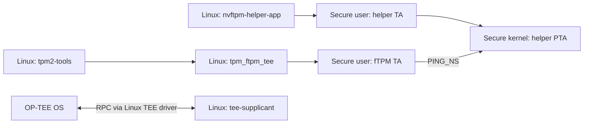

# Comparing OP-TEE daemons, TAs, PTAs and services

[日本語](../optee-service-comparison.md) | English

This investigation uses the NVIDIA L4T R36.5.2 sources included in this repository.
**The missing helper PTA is not a helper daemon running on Linux.**
It is a Pseudo Trusted Application registered inside the OP-TEE OS kernel.
The earlier description as an auxiliary service did not make this distinction clear.

## Execution locations and roles

| Component | Location and type | Services | Current option-B profile |
| --- | --- | --- | --- |
| `tee-supplicant` | Normal-world Linux process; resident daemon | OP-TEE RPC handling: external TA loading, REE filesystem operations, shared-memory allocation/free, RPMB and others | NVIDIA client installed; daemon startup verified |
| `nvftpm-helper-app` | Normal-world Linux command-line client application (CA); not a resident daemon | Invokes the helper TA for manufacturing/provisioning queries and operations | Installed; actual PTA APIs tested through a separate relay client |
| fTPM helper TA | Secure-world OP-TEE user-mode TA; UUID `a6a3a74a-77cb-433a-990c-1dfb8a3fbc4c` | Bridges the Linux CA to the helper PTA; includes CSR processing | Embedded as a B2 Early TA; API tests use a relay TA |
| fTPM helper PTA | Secure-world OP-TEE kernel PTA; UUID `6c879517-2dfc-4663-863d-4896e8ccbe3a` | Normal-world readiness, SN/ECID, certificate and provisioning APIs | B2 includes the complete PTA; enabled APIs, signing and certificates verified using test data |
| fTPM TA | Secure-world OP-TEE user-mode TA; UUID `bc50d971-d4c9-42c4-82cb-343fb7f37896` | TPM 2.0 command implementation | Unchanged Early TA; command execution and cold-boot persistence verified |
| `tpm_ftpm_tee` | Normal-world Linux kernel driver | Connects the Linux TPM subsystem to the fTPM TA | NVIDIA distributed module passed TPM command tests |

The helper PTA's open-session implementation checks that its caller is a user TA.
Linux management operations use the helper TA rather than calling the PTA directly.
The fTPM TA calls the helper PTA directly, without the helper TA.
Starting or restarting tee-supplicant cannot install a PTA missing from OP-TEE.

## Defined helper PTA APIs and the B1/B2 difference

Every command below has the prefix `FTPM_HELPER_PTA_CMD_`.
[The user selected B2](decisions/0002-ftpm-helper-pta.md). The table preserves the alternatives and does not claim a completed port.
For B2, inclusion in the port describes source/API scope, not guaranteed success or physical-device key protection.

| Command (value) | NVIDIA implementation and dependencies | B1: minimal compatible PTA | B2: port the full NVIDIA PTA |
| --- | --- | --- | --- |
| `PING_NS` (`0xffff0001`) | Reads OP-TEE's REE state and reports supplicant readiness | Implement using actual REE state, not a fixed READY | Included in port |
| `QUERY_SN` (`0xffff0002`) | Gets a 10-byte SN through the Fuse API | Explicitly unsupported | Included; requires Fuse API integration |
| `QUERY_ECID` (`0xffff0003`) | Gets an 8-byte, 64-bit ECID through the Fuse API | Explicitly unsupported | Included; requires Fuse API integration |
| `QUERY_PROV_MODE` (`0xffff0004`) | Returns offline/online mode and API version 2.0 from initialized fTPM properties | Explicitly unsupported | Included; requires provisioning-state initialization |
| `GET_RSA_EK_CERT` (`0xffff0005`) | Retrieves the RSA EK certificate | Explicitly unsupported | Included; requires certificate data |
| `GET_EC_EK_CERT` (`0xffff0006`) | Retrieves the EC EK certificate | Explicitly unsupported | Same |
| `GET_SID_CERT` (`0xffff0007`) | Retrieves the Silicon ID certificate | Explicitly unsupported | Same |
| `GET_FW_ID_CERT` (`0xffff0008`) | Retrieves the Firmware ID certificate | Explicitly unsupported | Same |
| `GET_RSA_EK_CSR` (`0xffff0009`) | Retrieves the RSA EK certificate signing request | Explicitly unsupported | Included; requires CSR data |
| `GET_EC_EK_CSR` (`0xffff000a`) | Retrieves the EC EK certificate signing request | Explicitly unsupported | Same |
| `SIGN_EK_CSR` (`0xffff000b`) | Signs an EK CSR digest | Explicitly unsupported | Included; requires initialized signing key |
| `INJECT_EPS` (`0xffff000c`) | Sets an external 64-byte Endorsement Primary Seed | Explicitly unsupported | Conditional; implemented only with `CFG_JETSON_FTPM_HELPER_INJECT_EPS` |

NVIDIA's PTA also returns errors when data or initialization is missing. API presence does not imply availability.
Before B2, the PTA was absent and session creation failed before command dispatch. B2 includes the full PTA; see [port status](ftpm-helper-port.md) for build and boot results.

## Direct dependencies of the fTPM TA

In the examined NVIDIA fTPM TA source, `PING_NS` is the only directly invoked helper PTA command.
When the normal world is ready, the TA enables NV storage and timer availability and transitions out of early boot behavior.
This is the reason for recommending B1 to prioritize TPM command verification; it is not evidence that B1 already makes every TPM feature work.

With `CFG_USE_PLATFORM_EPS=y`, EPS retrieval uses the separate OP-TEE property path
`com.microsoft.ta.endorsementSeed`.
Option B's HUK-derived EPS adaptation implements that path and does not replace the full helper PTA.

When enabling fTPM, NVIDIA's `optee_src_build.sh` sets
`CFG_REE_STATE=y` and `CFG_JETSON_FTPM_HELPER_PTA=y`.
The pre-B2 QEMU build bypassed that platform-specific script and enabled neither option. B2 enables both through `CFG_QEMU_JETSON_FTPM=y`.
B1 also needs `CFG_REE_STATE`; without it, `tee_get_ree_state()` returns UNKNOWN.

The REE state sequence is:

1. The secure-side initial state is BOOT.
2. Linux device enumeration calls `PTA_CMD_GET_DEVICES`, setting REE_OS.
3. Opening the supplicant TEE device triggers Linux to call `PTA_CMD_GET_DEVICES_SUPP`, setting REE_SUPP.
4. The helper PTA's `PING_NS` reports READY only for REE_SUPP.

This records an OP-TEE enumeration stage; it does not check the health of all Linux services.

## Relationship to Linux systemd services

| Unit | Origin and purpose | Current state |
| --- | --- | --- |
| `jetson-tee-supplicant.service` | Defined by this project to run NVIDIA's tee-supplicant | The functional profile starts it before udev coldplug to avoid a circular RPC wait |
| `ftpm-functional-test.service` | Defined by this project for TPM command/persistence tests | Test-only; initial and reboot phases passed |
| `systemd-sysusers.service` / `systemd-resolved.service` | Ubuntu user creation and name resolution services | PRoot passwd/group binding fixed in rootfs; successful startup verified |

This configuration defines no separate systemd daemon for nvftpm-helper-app or the PTA.

## Source evidence

- [PTA API header](../../optee/optee/optee_os/lib/libutee/include/pta_jetson_ftpm_helper.h)
- [PTA implementation and caller check](../../optee/optee/optee_os/core/pta/tegra/jetson_ftpm_helper_pta.c)
- [Helper TA](../../optee/optee/samples/ftpm-helper/ta/ftpm_helper_ta.c), [helper CA main](../../optee/optee/samples/ftpm-helper/host/ftpm_helper_ca.c)
- [fTPM initialization and PING_NS](../../optee/optee/samples/ms-tpm-20-ref/Samples/ARM32-FirmwareTPM/optee_ta/fTPM/fTPM.c)
- [REE state API](../../optee/optee/optee_os/core/include/tee/tee_ree_state.h), [device enumeration PTA](../../optee/optee/optee_os/core/pta/device.c)
- [Linux supplicant connection](../../kernel/kernel/kernel-jammy-src/drivers/tee/optee/core.c)
- [Supplicant RPC dispatch](../../optee/optee/optee_client/tee-supplicant/src/tee_supplicant.c)
- [NVIDIA build settings](../../optee/optee_src_build.sh), [current QEMU build](../../scripts/build-ftpm-virt-firmware.sh)

See [current results and coverage](ftpm-functional-validation.md).
