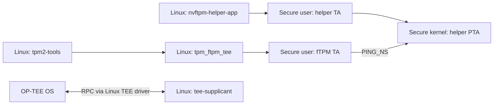

# OP-TEEのデーモン・TA・PTAとサービスの比較

日本語 | [English](en/optee-service-comparison.md)

調査対象は、このリポジトリに格納したNVIDIA L4T R36.5.2のソース。
**今回不足しているhelper PTAは、Linuxで動くhelper daemonではない。**
OP-TEE OSのカーネル内に登録されるPseudo Trusted Applicationである。
前回の「補助サービス」という表現だけではこの区別が分かりにくかったため、以下に整理する。

## 実行場所と役割

| 部品 | 実行場所・種別 | 提供するもの | 現在のB案 |
| --- | --- | --- | --- |
| `tee-supplicant` | 通常世界のLinuxプロセス。常駐デーモン | OP-TEEからのRPC。外部TAロード、REEファイル操作、共有メモリ割当・解放、RPMBなど | NVIDIA版クライアントを配置し、起動を確認済み |
| `nvftpm-helper-app` | 通常世界のLinuxコマンドラインツール（CA）。常駐デーモンではない | helper TAを呼び、製造・プロビジョニング関連の問い合わせや操作を行う | 配置済み。呼出先のTA/PTAを含む動作は未確認 |
| fTPM helper TA | セキュア世界、OP-TEEユーザー空間のTA。UUID `a6a3a74a-77cb-433a-990c-1dfb8a3fbc4c` | LinuxのCAとhelper PTAの仲介、CSR処理など | 現在のQEMU用Early TAには未搭載 |
| fTPM helper PTA | セキュア世界、OP-TEEカーネル内のPTA。UUID `6c879517-2dfc-4663-863d-4896e8ccbe3a` | 通常世界の準備状態、SN/ECID、証明書・プロビジョニング関連API | 未搭載。実行時に`ITEM_NOT_FOUND`を確認した対象 |
| fTPM TA | セキュア世界、OP-TEEユーザー空間のTA。UUID `bc50d971-d4c9-42c4-82cb-343fb7f37896` | TPM 2.0コマンドの実装 | ソース無変更でビルドしEarly TAに埋め込み。コマンド試験は未完了 |
| `tpm_ftpm_tee` | 通常世界のLinuxカーネルドライバ | Linux TPMサブシステムとfTPM TAの接続 | NVIDIA配布モジュールを使用。正常動作は未確認 |

PTAのopen-session実装は、呼び出し元がユーザーTAであることを検査する。
Linuxからhelper PTAを直接呼ぶ構成ではなく、管理操作はhelper TAを経由する。
fTPM TA自身はhelper TAを経由せずhelper PTAを直接呼ぶ。
`tee-supplicant`を起動・再起動しても、組み込まれていないPTAが追加されることはない。

## helper PTAに定義されているAPIとB1・B2の違い

コマンドの接頭辞はすべて`FTPM_HELPER_PTA_CMD_`。
B1/B2は[判断待ちの候補](decisions/0002-ftpm-helper-pta.md)であり、いずれも実装済みではない。
B2の「移植対象」はソース/APIの対応範囲を意味し、全機能の成功や実機相当の鍵保護を保証しない。

| コマンド（値） | NVIDIA実装の役割・依存 | B1：最小互換PTA | B2：NVIDIA PTA全体の移植 |
| --- | --- | --- | --- |
| `PING_NS` (`0xffff0001`) | OP-TEE内部のREE状態を読み、supplicant準備状態を返す | 対応。固定READYではなく実際のREE状態を使う | 移植対象 |
| `QUERY_SN` (`0xffff0002`) | Fuse APIからSNを取得（10バイト） | 未対応を明示 | 移植対象。Fuse APIとの接続が必要 |
| `QUERY_ECID` (`0xffff0003`) | Fuse APIから64ビットECIDを取得（8バイト） | 未対応を明示 | 移植対象。Fuse APIとの接続が必要 |
| `QUERY_PROV_MODE` (`0xffff0004`) | 初期化済みのfTPMプロパティからoffline/onlineモードとAPIバージョン2.0を返す | 未対応を明示 | 移植対象。プロビジョニング状態の初期化が必要 |
| `GET_RSA_EK_CERT` (`0xffff0005`) | RSA EK証明書を取得 | 未対応を明示 | 移植対象。証明書データが必要 |
| `GET_EC_EK_CERT` (`0xffff0006`) | EC EK証明書を取得 | 未対応を明示 | 同上 |
| `GET_SID_CERT` (`0xffff0007`) | Silicon ID証明書を取得 | 未対応を明示 | 同上 |
| `GET_FW_ID_CERT` (`0xffff0008`) | Firmware ID証明書を取得 | 未対応を明示 | 同上 |
| `GET_RSA_EK_CSR` (`0xffff0009`) | RSA EKの証明書署名要求を取得 | 未対応を明示 | 移植対象。CSRデータが必要 |
| `GET_EC_EK_CSR` (`0xffff000a`) | EC EKの証明書署名要求を取得 | 未対応を明示 | 同上 |
| `SIGN_EK_CSR` (`0xffff000b`) | EK CSRのダイジェストを署名 | 未対応を明示 | 移植対象。対応する署名鍵の初期化が必要 |
| `INJECT_EPS` (`0xffff000c`) | 外部EPS（Endorsement Primary Seed、64バイト）を設定 | 未対応を明示 | 条件付き移植対象。`CFG_JETSON_FTPM_HELPER_INJECT_EPS`有効時のみ実装 |

NVIDIAのPTAでも、データや初期化状態が不足する場合は失敗する。APIの存在と利用可能性は別である。
現在のQEMU構成ではPTA自体が存在しないため、上記の各コマンドへ到達する前にセッション作成が失敗する。

## fTPMが直接必要とするもの

調査したNVIDIA fTPM TAソース中、helper PTAコマンドの直接呼出しは`PING_NS`のみ。
通常世界が準備済みならNVストレージ・タイマーを利用可能とし、早期起動モードから切り替える。
このことが、TPMコマンドの検証を優先するB1を推奨した根拠である。B1で全TPM機能が動くという検証結果ではない。

EPS取得はこの`PING_NS`とは別のOP-TEEプロパティ経路
`com.microsoft.ta.endorsementSeed`を使う（`CFG_USE_PLATFORM_EPS=y`）。
B案のHUK由来EPS処理はこの経路の追加であり、helper PTA全体の代替ではない。

NVIDIAの`optee_src_build.sh`ではfTPMを有効にすると
`CFG_REE_STATE=y`と`CFG_JETSON_FTPM_HELPER_PTA=y`を指定する。
現在のQEMU用ビルドはこの専用スクリプトを経由せず、この2つは有効になっていない。
B1でも`CFG_REE_STATE`を有効にする必要がある。無効時の`tee_get_ree_state()`はUNKNOWNを返す。

REE状態の流れは次のとおり。

1. セキュア側の初期状態はBOOT。
2. Linuxのデバイス列挙が`PTA_CMD_GET_DEVICES`を呼ぶとREE_OSになる。
3. supplicantによるTEEデバイスのopenを契機に、Linuxが`PTA_CMD_GET_DEVICES_SUPP`を呼ぶとREE_SUPPになる。
4. helper PTAの`PING_NS`はREE_SUPPの場合だけREADYを返す。

これはOP-TEEが記録する列挙段階の通知であり、Linux全サービスの健全性を検査するヘルスチェックではない。

## Linuxのsystemdサービスとの関係

| ユニット | 出自と役割 | 現状 |
| --- | --- | --- |
| `jetson-tee-supplicant.service` | 本プロジェクトが定義。NVIDIA版`tee-supplicant`を常駐させる | 機能検証プロファイルではudev coldplugより前に起動し、RPC待ちとの循環を避ける |
| `ftpm-functional-test.service` | 本プロジェクトが定義。TPMコマンド・永続化試験 | テスト用。成功未確認 |
| `systemd-sysusers.service` / `systemd-resolved.service` | Ubuntuのユーザー作成／名前解決サービス | 起動失敗が残る。helper PTAとは別の問題で、原因は未確定 |

`nvftpm-helper-app`やPTAを起動する独立したsystemdデーモンは、この構成では定義していない。

## ソース根拠

- [PTA APIヘッダ](../optee/optee/optee_os/lib/libutee/include/pta_jetson_ftpm_helper.h)
- [PTA実装・呼出元検査](../optee/optee/optee_os/core/pta/tegra/jetson_ftpm_helper_pta.c)
- [helper TA実装](../optee/optee/samples/ftpm-helper/ta/ftpm_helper_ta.c)、[helper CAのmain](../optee/optee/samples/ftpm-helper/host/ftpm_helper_ca.c)
- [fTPM TAの初期化とPING_NS](../optee/optee/samples/ms-tpm-20-ref/Samples/ARM32-FirmwareTPM/optee_ta/fTPM/fTPM.c)
- [REE状態API](../optee/optee/optee_os/core/include/tee/tee_ree_state.h)、[デバイス列挙PTA](../optee/optee/optee_os/core/pta/device.c)
- [Linuxのsupplicant接続時処理](../kernel/kernel/kernel-jammy-src/drivers/tee/optee/core.c)
- [supplicant RPCディスパッチ](../optee/optee/optee_client/tee-supplicant/src/tee_supplicant.c)
- [NVIDIAビルド設定](../optee/optee_src_build.sh)、[現在のQEMU用ビルド](../scripts/build-ftpm-virt-firmware.sh)
